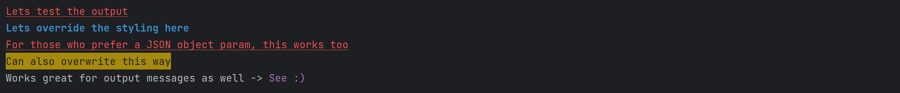
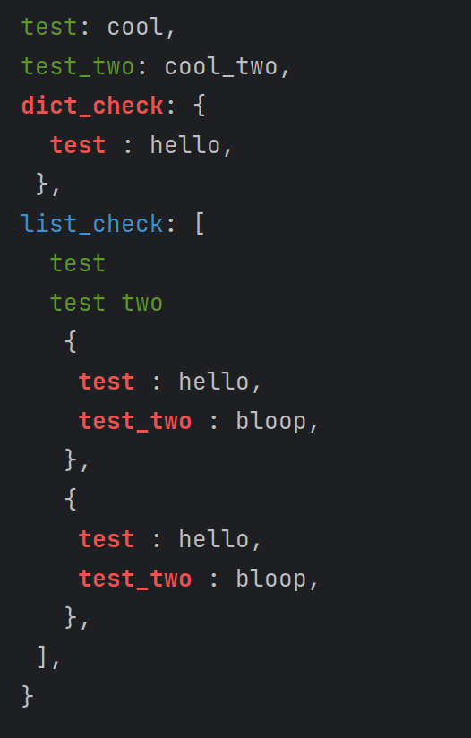

# Prettier_prints

[](https://pypi.org/project/prettier-prints/)
[](https://github.com/PhantomLeak/prettier_prints/blob/main/LICENSE)
[](https://pepy.tech/project/prettier-prints)

**[Chalk](https://github.com/chalk/chalk)-style terminal colors for Python. Tiny, zero dependencies, chainable, nestable.**

<!-- TODO: demo GIF goes here -->

```python
from prettier_prints.prettier_printsv2 import Output

pp = Output()
print(pp.msg("Error:").red().bold(), "file not found")
print(pp.msg(f"Saved {pp.msg('config.yml').bold()}").green())
```

```bash
pip install prettier-prints
```

### Why prettier_prints?
- **Zero dependencies**: pure Python, nothing else to install.
- **Chain and nest freely**: `.red().bold()` reads left to right, and inner styles never cancel outer ones.
- **Drop it in anywhere**: styled values work directly in `print`, f-strings and `logging`.
- **Pretty JSON too**: print dicts and lists as colored, valid JSON at any depth.

## Examples

### v2: chainable `Output` (recommended)
```python
from prettier_prints.prettier_printsv2 import Output

pp = Output()
print(pp.msg('Hello').red().bold().underline())
print(pp.msg('Hello').green().bold().out())   # .out() returns the plain styled str

# Every call returns a NEW value, so results can be stored and reused safely
error = pp.msg('error').bright_red().bold()
ok = pp.msg('ok').green()
print(error, ok)

# Styles nest: inner styling doesn't cancel the outer style
print(pp.msg(f"Could not find {pp.msg('config.yml').bold()} in project").red())
```

### v1: `PrettierPrints.out()`
```python
from prettier_prints.prettier_prints import PrettierPrints

pp = PrettierPrints()
pp.style = 'red;underline'  # <-- Can optionally predefine styling and can be overwritten

print(pp.out(msg="Lets test the output"))
print(pp.out(msg="Lets override the styling here", style="blue;bold"))
print(pp.out(json_out={'msg': 'For those who prefer a JSON object param, this works too'}))
print(pp.out(json_out={'msg': 'Can also overwrite this way', 'style': 'yellow;highlight'}))
print(f'Works great for output messages as well -> {pp.out(msg="See :)", style="magenta")}')
```


### v1: `PrettierPrints.json()` / `json_str()`
```python
from prettier_prints.prettier_prints import PrettierPrints

pp = PrettierPrints()
json_obj = {'test': 'cool', 'test_two': 'cool_two', 'dict_check': {'test': 'hello'},
            'list_check': [
                'test',
                'test two',
                {'test': 'hello', 'test_two': 'bloop'},
                {'test': 'hello', 'test_two': 'bloop'}
            ]}

# json() prints the styled output directly
pp.json(json_obj=json_obj, style='list=blue;underline&dict=red;bold&string=green')

# json_str() returns it as a string instead
styled = pp.json_str(json_obj, style='string=cyan')
```
Output is valid JSON (2-space indent, any depth): with the colors removed it is identical to
`json.dumps(json_obj, indent=2, ensure_ascii=False)`. Keys are colored by the type of their value
(`dict`, `list`, or `string` for anything else), plain values inside lists use the `string` style,
and other values are left uncolored.



## Reference

### Functions
 - v2 `Output`: `msg()`, any color/modifier method below, `out()`
 - v1 `PrettierPrints`: `out()`, `json()`, `json_str()`

### Function parameters (v1)
     - out()
       - msg: Any           Output / display message [required, unless given in json_out]
       - style: str         Styling to apply to the message [optional]
       - json_out: dict     Object containing 'msg' and optionally 'style' [optional]

     - json() / json_str()
       - json_obj: dict | list   Object to display [required]
       - style: str              Styling per type [optional]

`out()` accepts any message, including `0`, `False` and `''`; only a missing message is an error.
Invalid input raises `ValueError` (`out()` with no message, `json()`/`json_str()` with `None`).
An empty `{}` or `[]` is valid JSON and is printed as-is.

### Styling syntax (v1)
    - out()
        - style: 'red;underline'                       # ';' separates styles
        - json_out: {'msg': 'Lets test the output', 'style': 'blue;bold'}
    - json() / json_str()
        - style: 'list=red;underline&dict=blue;bold&string=yellow;highlight'
          # '&' separates types (list, dict, string); 'str=' also works for string.
          # Any type can be set on its own (e.g. 'string=red'); unset types keep their defaults:
          # list=red, dict=magenta, string=green

Without a color, text keeps your terminal's default color (e.g. `style='bold'` is bold only).
Unknown style names are ignored.

### Available styling
Use these names in v1 style strings, or as v2 methods (e.g. `.bright_red()`, `.underline()`).

| Modifiers   | Colors    | Bright colors                 |
|:------------|:----------|:------------------------------|
| `bold`      | `black`   | `bright_black` (gray)         |
| `underline` | `red`     | `bright_red`                  |
| `highlight` | `green`   | `bright_green`                |
|             | `yellow`  | `bright_yellow`               |
|             | `blue`    | `bright_blue`                 |
|             | `magenta` | `bright_magenta`              |
|             | `cyan`    | `bright_cyan`                 |
|             | `white`   | `bright_white`                |

`highlight` swaps the text and background colors. Background colors are not supported yet.

## Running tests
From the repository root:
```bash
pip install pytest
python -m pytest            # results only
python -m pytest --output   # also display color swatches, nested styles and JSON samples
```
Combine with pytest's own flags as usual, e.g. `python -m pytest -v --output`.
The tests also run without pytest: `python -m unittest discover -s tests -t .` (visual output is not shown).

## What's new in 3.1.0
- v2 `Output` calls return new values instead of modifying the original, so stored results
  no longer overwrite each other. Code that relied on in-place changes
  (`pp.msg('x'); pp.red(); print(pp)`) should use chaining instead.
- Nested styles keep the outer style; bright colors use true bright codes (90-97).
- v2 gains `black()` and `bright_black()`.
- `json()` supports any nesting depth and prints valid JSON; new `json_str()` returns it as a string.
- `json()` style parsing applies a single setting (e.g. `'string=red'`) and accepts `str=`.
- `out()` with no style returns the plain message; modifiers no longer force white text.
- Errors are raised as `ValueError` (still caught by `except Exception`).

### Contributors / Thanks:
 - [SheepDogg586](https://github.com/SheepDogg586)
